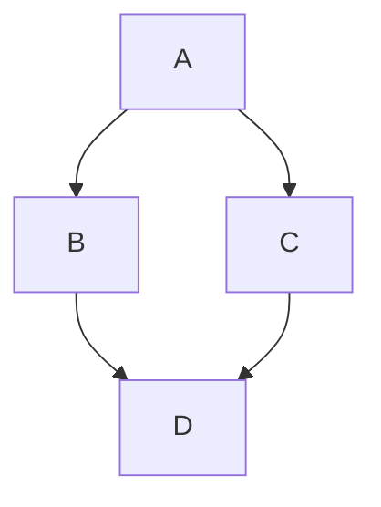

# Introduction
Databases of geolocated samples and occurrences are central to life science data resources, including [ELIXIR Core Data Resources](https://elixir-europe.org/platforms/data/core-data-resources) (CDRs). 
For example, CDR the European Nucleotide Archive (ENA) and other International Nucleotide Sequence Database Collaboration (INSDC) nodes have mandated spatiotemporal metadata for samples submitted since 2023 [@citesAsAuthority:Yuan2004]. Similarly metagenomics CDR MGnify, and its emerging eDNA sister-project EnvIdent, add analysis layers on top of ENA records which, especially when related to environmental sampling, are frequently searched for and analysed in the context of their locations.

A common challenge for large databases (e.g. 100,000+ geolocated entries) is handling search queries across the scale of the entire database.
Common patterns to support this include: 

1. adding database table indexes within a relational database (e.g. B-trees to limit how many rows are considered for search instead of a full-table scan; Full Text Search indexing via n-grams on strings like sample desriptions; Generalised Inverted Indexes (GIN) for hierarchical or nested JSON metadata.)
2. indexing a source relational database into a separately run query-optimised service (e.g. Elastic Search) so that data are denormalised between two systems

However, geospatial data present a unique challenge.
Whilst named locations (e.g. countries, cities, named water bodies etc) can be treated as strings and even normalised onto controlled vocabularies like [INSDC's `geo_loc_name`](https://www.insdc.org/submitting-standards/geo_loc_name-qualifier-vocabulary/) or ISO 3166-1 country codes, making them readily indexable and efficiently queryable with standard solutions, precise latitude, longitude and related geometrical searches like bounding-boxes require coordinate-system aware indexing.
This is especially true when grouping database entries: for example facet-search indexing provided by tools like ElasticSearch can very efficiently perform a search for "Collection date: 2026" and show entry counts within further search facets (e.g., Country code: FR (123,456 samples), Country code: DE (98,765 samples)).

The coordinate equivalent of these facet groups is grid-based or proximity-based clustering: given a set of search query facets, efficiently group and count the resulting entries by their relative lat/lon coordinates.
The canonical display of these groups is a map projection with cluster markers marking the centroid of each grid/proximity group and the count of samples it represents, with finer zoom levels performing clustering at finer grid scales or smaller proximity radii.

Algorithms for these spatial query and cluster algorithms is available in specialised packages, typically not part of standard software builds.
Notable examples of this pattern are [GeoPandas](https://geopandas.org), which provided geospatial datatypes and algorithms compatible with the more generic and widely used [Pandas](https://pandas.pydata.org/) python data analysis library; and [PostGIS](https://postgis.net/) which extends the [PostgreSQL](https://www.postgresql.org/) relational database system.

As part of the BioHackathon Europe 2026, we developed SampleSift as a full-stack solution to adding geospatial-plus-metadata querying to existing databases of geolocated items like samples or occurrences.
In this report we detail the technologies investigated and those chosen for the initial version, the adoption of the package for the life science data repositories we targetted, and possible future extensions for use cases we identified but couldn't directly serve with the initial version.


# Methods

## Use case investigation
We explored possible use cases for SampleSift including those that emerged through discussion with other BioHackathon 2026 projects, and initially considering the needs of [MGnify](https://www.ebi.ac.uk/metagenomics/), CartoGenomics, EnvIdent, Branchwater, and Zenodo-hosted datasets like the [SMAG soil genome catalogue](https://zenodo.org/records/8223844).

These broadly fit into two categories: existing Django-based databases that wish to easily adopt the full SampleSift stack, and large file-based tabular datasets where a queryable map view would add value to a single dataset (a Branchwater result set, and a Zenodo-hosted genome catalogue).

## Database selection
We considered three primary database ecosystems: Postgres, SQLite and DuckDB.
These suit the two use case categories above, respectively, with Postgres and SQLite being suitable for classical database-backed services and DuckDB being suitable for querying individual large datasets via Parquet files, for example.

For the purposes of the hackathon, we focussed on the relational DBs, and selected the Postgres ecosystem as the most capable option, with the expectation that SQLite and Spatialite would follow PostgreSQL and PostGIS as lighter weight, slightly limited alternatives for some use cases.

## Adoption path
A consideration from use case conversations was that SampleSift should be easy to adopt into (and to eject from) existing databases.
For example, switching database technologies – even amongst seemingly similar choices like MySQL or Oracle DB to Postgres – is often a major development effort, especially for production services where a user community relies on levels of resilience and permanence that mean relatively involved database backup strategies, for example, are required as part of development.
Similarly, making software packages choices that are hard to undo increases the cost of adoption due to the risk of future technological debt.

Together, these realities led us to design SampleSift as a "bolt-on" package that manages its own database (or table namespace) which is assumed to be transient: closer to a cache than a data store.
We also chose to develop a relatively tightly-coupled backend and frontend, so that the entire stack is relatively easy to install, and in future to remove if needed.
For example the SampleSift API is not designed to offer much utility beyond enabling the frontend user interface (the map and filters) to function; although it is based on standards where appropriate so it also does not preclude such API-first use cases should they exist.

In the initial implementation, which targets Django, SampleSift can be configured to use any of a Django application's configured database aliases, and handles its tablespace schema creation independently of Django migrations. 
These choices allow a transient PostGIS database to be used for SampleSift, independent of the requirements of the Django application's source database.

We chose to use Liv web components for the frontend user interface.
Lit web components are HTML-native, so are inherently framework agnostic and can be used within a web interface developed with any other framework (like React, Svelte, Vue etc) or none.
This choice also mirrors that of [Nightingale web components](https://ebi-webcomponents.github.io/nightingale/) (CITE https://pubmed.ncbi.nlm.nih.gov/37359723/), a suite of Lit web components developed during previous editions of ELIXIR BioHackathon Europe.


## Query specification
SampleSift provides an interface to generate queries that select by (mandatorily) geospatial positions and (optionally) other metadata like continuous or categorical variables, and arbitrary fields.
[Common Query Language 2](https://schemas.opengis.net/cql2/), a standard proposed by the Open Geospatial Consortium (OGC), provides a grammar for representing these queries, as well as text and JSON encodings of this grammar.
For example, filtering a collection of geolocated entries to find those within a lat/lon bounding box defining the [Viking shipping region of the North Sea](https://www.metoffice.gov.uk/api/assets/file/factsheet_8_shipping_forecast_2025pdf), with `depth` metadata greater than 50m might be represented in CQL2 JSON as:

```json
{
  "op": "and",
  "args": [
    {"op": ">=", "args": [{"property": "depth"}, 50]},
    {
      "op": "s_intersects",
      "args": [
        {"property": "geometry"},
        {"bbox": [0, 58.5, 4, 61]}
      ]
    }
  ]
}
```

CQL2 is thus an ideal standard for SampleSift to adopt as the serialization of requests sent between the frontend mapping and filtering user interface and the backend API endpoints.

SampleSift embeds the CQL2-JSON encoding standard, within a further standard specification of its API surface: [OpenAPI Specification v3.2.1](https://spec.openapis.org/oas/v3.2.1.html) (OAS).
Each SampleSift collection is described by an OAS JSON document, which documents the endpoints in a standard, language-agnostic way including formal named schemas for the supported input (i.e. a CQL2 JSON query) and outputs (e.g. a JSON list representing the filtered collection, and `application/vnd.mapbox-vector-tile` binary map data-tiles representing the geospatial clusters for the map.

CQL2 provides a grammar for making a query [^1], but does not specify a grammar for specifying what operations and properties a collection supports.
For example, in a relational database setting, a query client needs to inspect a tables data definition language (DDL) document to know what tables and columns may be queried with which data types.
Alongside CQL2, OGC provides a standard for an [OGC API](https://docs.ogc.org/is/19-079r2/19-079r2.html).
SampleSift selectively follows its `queryables` pattern for documenting the filtering options a collection API supports, but extends it so that each queryable also lists its supported operations.

[^1]: CQL2 are typically idempotent retrievals (like an HTTP `GET` or `QUERY`, or a SQL `SELECT`) but they do not preclude effectual post/patch/update operations.

SampleSift implements this via a `/queryables` endpoint available for each collection, which returns a JSON Schema document similar to OGC API.
For example if a collection included a timestamp field `updated_at` that can be filtered, `/queryables` would include:

```json
{
  "$schema": "https://json-schema.org/draft/2020-12/schema",
  "type": "object",
  "properties": {
    "updated_at": {
      "type": "string",
      "format": "date-time",
      "x-samplesift": {
        "operators": [
          "=",
          "<>",
          "in",
          "isNull",
          ">",
          ">=",
          "<",
          "<="
        ]
      }
    },
    ...
  }
}
```

The use here of `x-samplesift` properties is an extension beyond OGC API, to hint to a client which operators may be used in the CQL2 clause for a queryable.
This "collection as the source of truth" design choice means the frontend component (or other API clients) can reliably construct queries that won't result in errors.


## Full-stack orchestration

The fully-specified query space for each SampleSift collection means that a SampleSift interface component can dynamically produce interface widgets for a collection's filters without additional configuration.
This lowers the cost of adoption for SampleSift, and prevents drift between frontend and backend codebases when, for example, a new queryable metadata property is added to the collection.

SampleSift uses [Golem UI](https://golemui.com/features/json-schema/) to interpret the queryables JSON Schemaand produce appropriate interface components.

Alongside the filter components, SampleSift's UI uses [MapLibre GL JS](https://maplibre.org/projects/gl-js/) to render map tiles for the (filtered and possibly clustered) collection.


## Django backend

The SampleSift backend currently supports Django only: it is an installable Django app that constructs the collections and endpoints for one or more source models.

Given a (potentially existing) Django model:

```python
class Sample(django.db.models.Model):
    lat = models.FloatField()
    lon = models.FloatField()
    depth = models.FloatField()
```

SampleSift, once installed and registered with Django via:

```python
INSTALLED_APPS = [..., "samplesift.django.apps.SamplesiftDjangoConfig", ...]
```

supports the addition of a new SampleSift collection by creating a `Model`-like configuration:

```python
@registry.register
class SampleCollection(SampleSiftCollection):
    fields = ["lat", "lon", "depth"]
    geometry = Point(longitude="lon", latitude="lat")

    class Meta:
        model = Sample
        api_name = "samples"
```

This configuration, including the use of a `registry` pattern following examples likeDjango's admin panel and Django Ninja, constitutes the majority of the change needed to adopt SampleSift into an existing Django codebase[^2].

[^2]: In the best-case scenario where the consuming Django app has an existing write-enabled PostGIS default database, the only other change needed is to register SampleSift's API namespace into Django's URLs.

SampleSift uses Django machinery to produce a `SampleCollection` model, and to ensure its schema has been propagated to the underlying database.
To achieve SampleSift's adoption ease goals, this does not use traditional Django migrations.
The rationale for avoiding these is that a consuming app may well wish to use a database without guaranteed permanence for SampleSift, for example a PostGIS container with container- or pod-lifecycle-limited attached storage on a kubernetes cluster.
This is envisioned as a pramatic way to install SampleSift alongside a non-geo-aware source database, e.g. MySQL or standard PostgreSQL, and conceptually follows the pattern used to index Django source tables into a sidecar query-optimised database used by the package [Django Elasticsearch DSL](https://django-elasticsearch-dsl.readthedocs.io/en/latest/).

SampleSift offers two approaches to populating the `SampleCollection` model: Django hooks triggered by the source `Sample` objects changing can refresh the `SampleCollection`'s drift from `Sample`, or management commands can recreate `SampleCollection` entirely for example in a nightly cron job.

To handle requests to the SampleSift endpoints, [`pygeofilter`](https://pygeofilter.readthedocs.io) is used to translate the CQL2 query into a Django queryset over the collection, and map data-tiles are generated by PostGIS with configurable clustering via `ST_Transform` (for the map projection); `ST_ClusterDBSCAN`, `ST_Collect`, and `ST_Centroid` to identify and locate proximal clusters; and `ST_AsMVTGeom` and `ST_AsMVT` to encode the vector tiles.


# Results

[SampleSift v0.1.1](https://pypi.org/project/samplesift/0.1.1/), developed and released during BioHackathon Europe 2026, is the initial Django-centric implementation of a PostGIS-backed geolocation-plus-metadata queryable map for large databases of samples or occurences.

It is available as a Python package on [PyPI/samplesift](https://pypi.org/project/samplesift/), for integration into a Django codebase, and on [NPM/@microbiome-informatics/samplesift](https://www.npmjs.com/package/@microbiome-informatics/samplesift) as a framework-agnostic Lit component to interface with a SampleSift API.

The user interface component supports three usage modes for integration into a consuming client:

1. Direct integration of the web component into a website frontend, to communicate with a SampleSift API
2. Within a Django template, a template tag embeds the Lit web component and configures it to communicate with the API of a named SampleSift collection within the same Django app
3. Bundled within a Jupyter Lab [`anywidget`](https://anywidget.dev/) that provides a bidirectional Python interface to the SampleSift web component.


## Package to add SampleSift to an existing Django codebase

## Framework-agnostic web component for rendering and querying SampleSift

## JupyterLab widget to integrate SampleSift in notebooks

## Implementation in existing data resources

### MGnify: ELIXIR's Core Data Resource for microbial metagenomics resource
The MGnify platform is an open resource for discovering and analysing microbiome sequencing data such as those archived in ELIXIR CDR, the [European Nucleotide Archive (ENA)](https://www.ebi.ac.uk/ena/browser/home). Providing taxonomic and functional annotation analyses for hundreds of thousands of geolocation-tagged biological samples and genomes, the MGnify web platform is an ideal use case for SampleSift. 

### EnvIdent: EMBL-EBI's resource for eDNA datasets

### Branchwater: mapping large results sets from ENA metagenomes with genome-scale queries

### CartoGenomics: a Digital Laboratory for the Global Biogeography of Prokaryotes

## Benchmarking
Measure a simulated user journey using:
- cached SampleSift default tiles, and then query by some depth filter. 10K samples. measurable like time to last paint?
- naive leaflet.js-on-postgres approach
- django-elasticsearch-dsl 

Benchmark mem requirements for clustering / tile-cache-warming 1K,10K,100K,1M,10M samples globally dispersed ?

# Discussion
TBC
Challenge known to many existing large scale occurence/sample DBs, how to have metadata+geospatial querying similar to facet search. ElasticSearch et al fulfil the typical search; how to add mapping?

Common challenge known to several ELIXIR CDRs and more.

## Future potential
E.g. Spatialite/Pglite/Duckdb, to serve use case such as "large MAG collection on Zenodo, how to add a nice serverless website on e.g. GitHub pages?"

---

# Some writing help stuff from the template


## Tables

Tables can be added in the following way, though alternatives are possible:

```markdown
Table: Note that table caption is automatically numbered and should be
given before the table itself.

| Header 1 | Header 2 |
| -------- | -------- |
| item 1 | item 2 |
| item 3 | item 4 |
```

This gives:

Table: Note that table caption is automatically numbered and should be
given before the table itself.

| Header 1 | Header 2 |
| -------- | -------- |
| item 1 | item 2 |
| item 3 | item 4 |

## Figures

A figure is added with:

```markdown

```

This gives:


Figures can be scaled by adding the width or height to the Markdown like this:

```markdown
{ width=50px }
```

You can add cross references to figures by adding a LaTeX `\label{figureCode}` to
the label of the Markdown figure and then use `\ref{figureCode}` to cite it:

```markdown
{ width=50px }
```

This way, we can cite Figure \ref{figureCode}.

## Mermaid graphs

[Mermaid](https://mermaid.js.org/) provides a solution to put diagrams in Markdown. BioHackrXiv
added support for this in 2026. This is an example of embedding a graph:




# Citation Typing Ontology annotation

You can use [CiTO](http://purl.org/spar/cito/2018-02-12) annotations, as explained in [this BioHackathon Europe 2021 write up](https://raw.githubusercontent.com/biohackrxiv/bhxiv-metadata/main/doc/elixir_biohackathon2021/paper.md) and [this CiTO Pilot](https://www.biomedcentral.com/collections/cito).
Using this template, you can cite an article and indicate _why_ you cite that article, for instance DisGeNET-RDF [@citesAsAuthority:Queralt2016].

The syntax in Markdown is as follows: a single intention annotation looks like
`[@usesMethodIn:Krewinkel2017]`; two or more intentions are separated
with colons, like `[@extends:discusses:Nielsen2017Scholia]`. When you cite two
different articles, you use this syntax: `[@citesAsDataSource:Ammar2022ETL; @citesAsDataSource:Arend2022BioHackEU22]`.

Possible CiTO typing annotation include:

* citesAsDataSource: when you point the reader to a source of data which may explain a claim
* usesDataFrom: when you reuse somehow (and elaborate on) the data in the cited entity
* usesMethodIn
* citesAsAuthority
* citesAsEvidence
* citesAsPotentialSolution
* citesAsRecommendedReading
* citesAsRelated
* citesAsSourceDocument
* citesForInformation
* confirms
* documents
* providesDataFor
* obtainsSupportFrom
* discusses
* extends
* agreesWith
* disagreesWith
* updates

There is a general `cites` intention, but this is already implied and should be left out.


## Acknowledgements

...

# References

```{=latex}
\AtEndDocument{%
```

# Appendices

If you want the Appendix (-ces) to show up after the references, wrap them in 
after the header, like done in this Markdown file. Look at the [source](paper.md)
to see the exact structure.

```{=latex}
}
```
